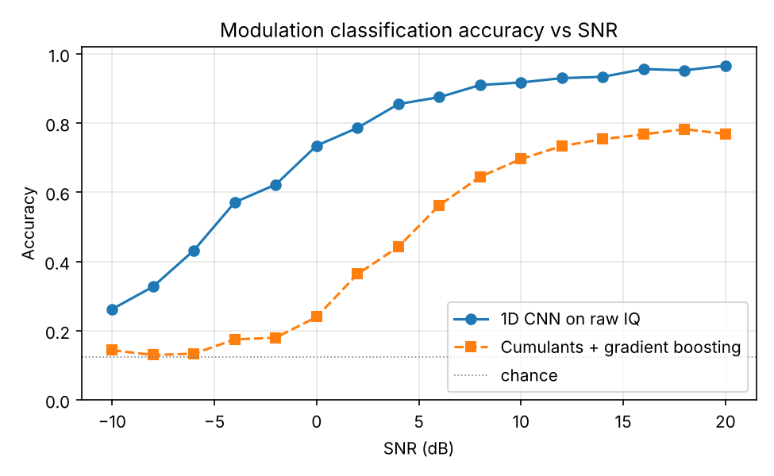
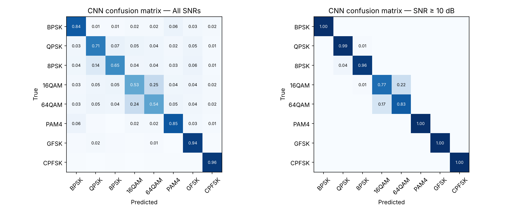
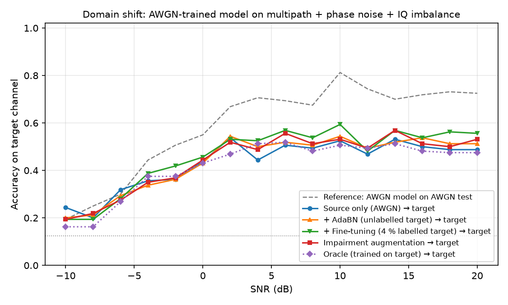
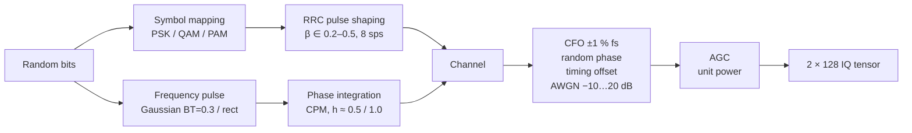
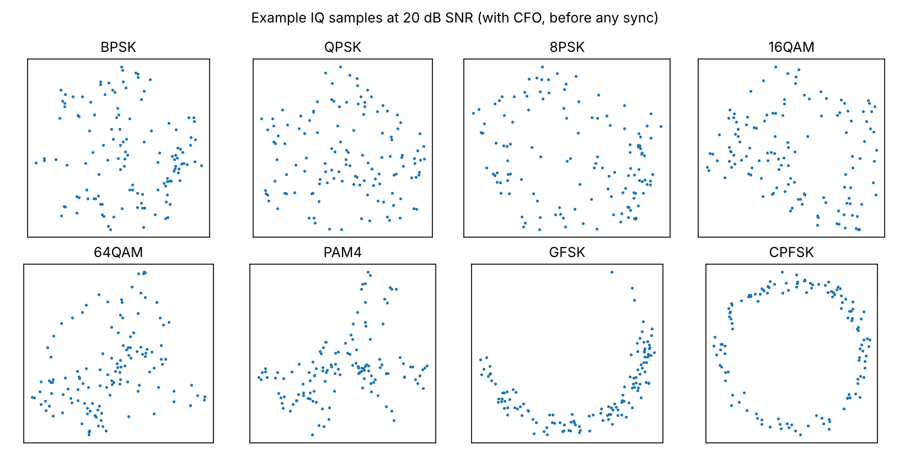

# Modulation Classification on Raw IQ Data


Blind classification of 8 digital modulation schemes directly from complex
baseband (IQ) samples, using a 1D convolutional neural network, compared against
a classical higher-order-cumulant baseline. The signal generator, channel model,
features and network are all implemented from scratch in NumPy and PyTorch.

<p align="center">
  
</p>

## Key results

8 classes, 2×128 IQ samples per example, SNR −10…+20 dB, held-out test set (20 %).

| Model | Overall | SNR ≥ 10 dB | SNR = 0 dB |
|---|:---:|:---:|:---:|
| **1D CNN on raw IQ** | **75.2 %** | **94.3 %** | **73.5 %** |
| Cumulants + gradient boosting | 47.0 % | 75.0 % | 24.0 % |
| Chance | 12.5 % | 12.5 % | 12.5 % |

- Above 10 dB, BPSK, PAM4, GFSK and CPFSK are classified perfectly, and QPSK/8PSK at 96–99 %.
- The CNN's margin is largest at low SNR: at 0 dB it is 3× more accurate than
  the cumulant features, whose estimates are too noisy over 128 samples.
- The main remaining error is **16QAM ↔ 64QAM** (~20 %). A 128-sample frame at
  8 samples/symbol contains only ~16 symbols, too few to visit all 64
  constellation points. This is a limit of the observation length rather than
  only of the model (tested in [Experiment 1](#experiment-1-observation-length)).

<p align="center">
  
</p>

<!-- LENGTH_STUDY -->

## Experiment 2: Domain shift to a realistic channel

**Question:** a model trained on clean simulated data is deployed on a channel
it has never seen. How much accuracy is lost, and which remedy recovers it?

**Target channel** (`TARGET` in `iqmodrec/dataset.py`), with all impairments always present:
- multipath fading: tapped delay line, exponential power-delay profile with
  1–4 samples rms delay spread (up to ½ symbol), Rician first tap (K = 0–5)
- oscillator phase noise: Wiener process, 0.01–0.03 rad/sample
- receiver IQ imbalance: 0.5–1.5 dB gain, 3–10° phase mismatch

| | Training data | Target labels needed | Target, overall | Target, SNR ≥ 10 dB |
|---|---|:---:|:---:|:---:|
| **A** Source only | AWGN | none | 45.5 % | 48.7 % |
| **B** A + AdaBN | AWGN + *unlabelled* target | none | 50.7 % | 57.9 % |
| **C** A + fine-tuning | AWGN + 1 280 labelled target frames (4 %) | few | 53.3 % | 64.2 % |
| **D** Impairment augmentation | synthetic, randomised impairments (`AUGMENT`) | none | **57.5 %** | **70.3 %** |
| **O** Oracle | target channel | all | 56.5 % | 69.6 % |

For reference, model A reaches 90.1 % at ≥ 10 dB on its own AWGN test set.

<p align="center">
  
</p>

**Findings**
- **The shift is severe.** At high SNR the AWGN model loses more than 40 points
  (90 % → 49 %). Its accuracy even *falls* as SNR rises above ~2 dB. The model
  has learned features that only hold in a clean channel, and at high SNR it
  relies on them confidently.
- **AdaBN** recovers 9 points without a single label. It only re-estimates the
  BatchNorm statistics on unlabelled target frames, which is cheap enough to do
  in the field.
- **Fine-tuning** on 4 % labelled target data recovers 16 points.
- **Physically modelled augmentation matches the oracle.** It was trained with
  *different*, wider parameter ranges than the target and never saw a target
  frame. This works because the impairments were modelled from first
  principles; it would not cover an impairment that was never modelled.
- **Even the oracle stops at ~70 %.** Without equalisation, ISI and phase noise
  remove information that distinguishes the higher-order constellations.
  The remaining gap to 90 % comes from the channel itself, not from mismatch.
- **Trade-off:** robustness costs accuracy on the clean channel (D: 81.5 % vs
  A: 90.1 % on AWGN at ≥ 10 dB).

```bash
python experiments/domain_shift.py   # ~30 min on a 2-core CPU
```

## Motivation

Automatic modulation classification (AMC) is a core task in spectrum monitoring,
cognitive radio and signal intelligence: before an unknown signal can be
demodulated, the receiver has to know what it is. Classical approaches use
hand-crafted statistics (cumulants, cyclostationary features); deep learning
on raw IQ, introduced by O'Shea et al., learns the features directly and is
more robust at low SNR.

## Signal chain

Every example is generated through a transmitter and channel with randomised
parameters, so the network cannot rely on a fixed carrier phase, frequency or
timing.



| Class | Family | Notes |
|---|---|---|
| BPSK, QPSK, 8PSK | PSK | RRC shaped |
| 16QAM, 64QAM | QAM | RRC shaped, unit average power |
| PAM4 | ASK | Real-valued, RRC shaped |
| GFSK | CPM | Gaussian BT = 0.3, h ≈ 0.5 (BLE-like) |
| CPFSK | CPM | Rectangular pulse, h ≈ 1.0 |

<p align="center">
  
</p>

SNR is defined as average signal power over noise power across the full
sampled bandwidth. The examples are not synchronised before classification, so
CFO rotates the constellations, as for a blind receiver.

## Models

**1D CNN** (`iqmodrec/model.py`, ≈250k parameters)
- Input: I and Q as two channels, shape `(2, L)`
- 4 blocks of [Conv1d → BatchNorm → ReLU] × 2 → MaxPool; widths 64-64-128-128
- Global average pooling → dropout → linear classifier; works for any frame length `L`
- Training: AdamW, one-cycle learning rate schedule, 25 epochs, random phase-rotation augmentation

**Cumulant baseline** (`iqmodrec/cumulants.py`)
- Magnitudes of the higher-order cumulants C40, C41, C42, C60, C63 and of M20
- Envelope variation and instantaneous-frequency statistics (to separate constant-envelope FSK)
- Histogram gradient boosting classifier

## Repository structure

```
iq-modulation-classification/
├── iqmodrec/              # Python package
│   ├── dataset.py         #   modulators, RRC/Gaussian filters, channel, dataset generator
│   ├── cumulants.py       #   higher-order-statistics feature baseline
│   └── model.py           #   1D CNN
├── tests/
│   └── test_dataset.py    # sanity checks: SNR calibration, unit power, filter energy, shapes
├── results/               # figures and metrics from the reference run
├── train.py               # data generation → training → evaluation → plots
├── requirements.txt
└── LICENSE
```

## Getting started

```bash
git clone https://github.com/sohui-lee-HH/iq-modulation-classification.git
cd iq-modulation-classification
python -m venv .venv && source .venv/bin/activate      # Windows: .venv\Scripts\activate
pip install -r requirements.txt

pytest                         # 8 sanity checks, ~2 s
python train.py --quick        # smoke test, ~1 min on CPU
python train.py                # full run, ~15 min on a 2-core CPU
python train.py --length 1024  # longer frames
```

`train.py` writes `accuracy_vs_snr.png`, `confusion.png`, `examples.png`,
`summary.json` (per-SNR accuracy and training history) and the model weights
to `results/` (or to the folder given with `--out`). No GPU is required; CUDA is used
automatically if available.

## Design decisions

- **Synthetic data first.** Every impairment is under my control, so every error
  can be explained. The 2×128 format matches RadioML 2016.10a, so the
  same pipeline can be applied to that dataset.
- **No synchronisation before the network.** CFO, phase and timing offsets are
  left in the data; the model has to be robust to them.
- **Phase-rotation augmentation.** The modulation label is invariant to carrier
  phase, so rotating IQ during training adds data at no cost.
- **Classical baseline.** Comparing against cumulants shows where deep learning
  actually helps (low SNR, short frames) and where hand-crafted features are
  already sufficient (FSK vs linear modulations at high SNR).

## Limitations

- AWGN channel only; no multipath fading, IQ imbalance, phase noise or
  sample-rate offset.
- Fixed oversampling (8 samples/symbol); a real receiver sees unknown symbol rates.
- Synthetic data only; no over-the-air captures yet.

## Next steps

- [ ] Frame length study: 128 vs 1024 samples, to test the 16QAM/64QAM explanation
- [ ] Rayleigh/Rician multipath and IQ imbalance in the channel model
- [ ] Evaluation on RadioML 2018.01A (24 classes, over-the-air effects)
- [ ] Architecture comparison: ResNet, LSTM, Transformer
- [ ] Real captures with an RTL-SDR or HackRF

## References

1. T. J. O'Shea, J. Corgan, T. C. Clancy, "Convolutional Radio Modulation Recognition Networks," *EANN*, 2016.
2. T. J. O'Shea, T. Roy, T. C. Clancy, "Over-the-Air Deep Learning Based Radio Signal Classification," *IEEE J. Sel. Topics Signal Process.*, 2018.
3. A. Swami, B. M. Sadler, "Hierarchical Digital Modulation Classification Using Cumulants," *IEEE Trans. Commun.*, 2000.

## Author

**Sohui** — M.Sc. Microelectronics and Microsystems (signal processing & communications), TUHH Hamburg
[LinkedIn](https://www.linkedin.com/in/sohui-lee-59b625296) · [GitHub](https://github.com/sohui-lee-HH)
